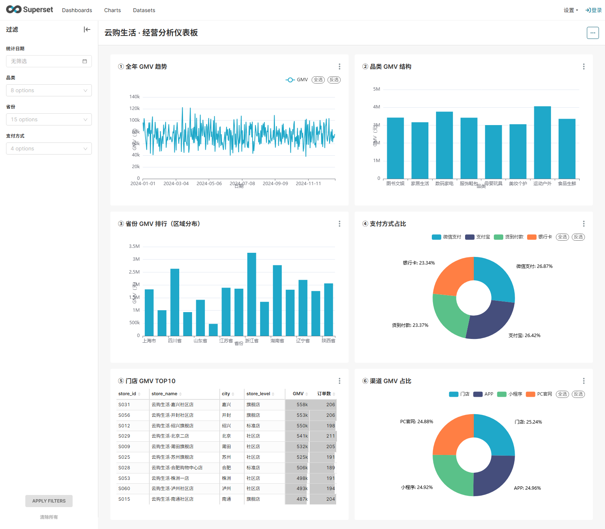
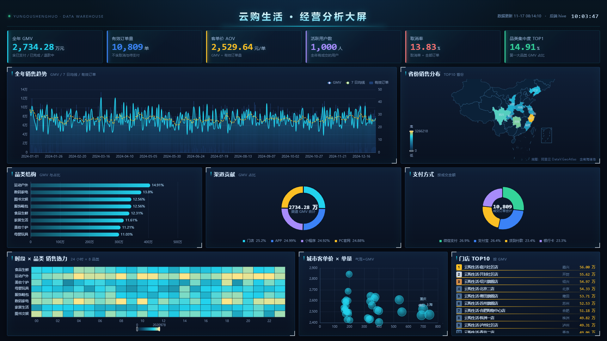
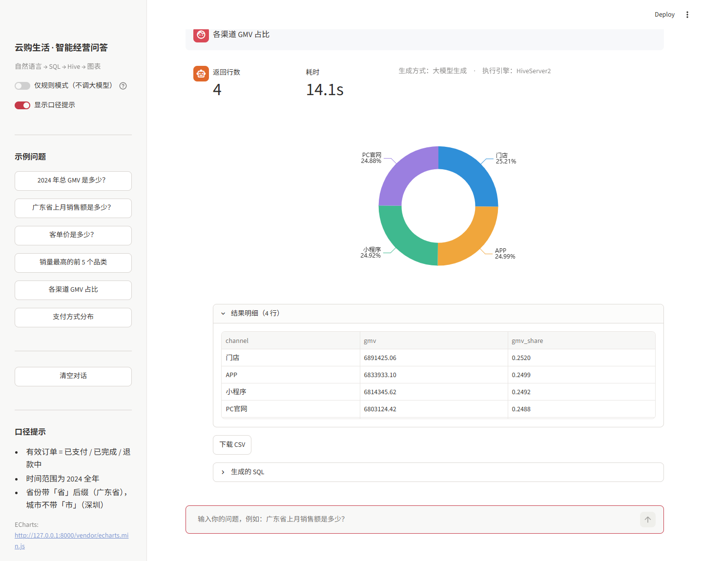

# 云购生活 · 企业级数据仓库与经营分析可视化系统

> 课程：企业项目实战实训｜数据科学与大数据技术
> 团队：**云购生活**｜成员：梁常金（独立完成，一人多岗）｜口号：让每一笔订单都可解释
> 仓库：<https://github.com/CjL0107/ydsh-dw>
> 当前进度：**第 4 周 —— Superset 可视化仪表板 · ECharts 数据大屏 · Docker 七服务一键部署** ✅ 已完成

---

## 📌 老师阅读指引（30 秒找到想看的内容）

本仓库四周成果都在这里，按下面顺序看最省时间：

| 想了解 | 直接点这里 |
|---|---|
| **第 4 周效果长什么样** | [第十三节 · 第 4 周成果展示](#十三第-4-周成果展示)（截图直接内嵌，无需装环境） |
| 系统整体架构 | [第二节 · 六层系统架构](#二六层系统架构) |
| 每周交付物清单 | [第十节](#十第-1-周提交物索引) / [十一节](#十一第-2-周提交物索引) / [十二节](#十二第-3-周提交物索引) / [十三节](#十三第-4-周成果展示) |
| 怎么在自己机器上跑起来 | [第五节 · 快速开始](#五快速开始)（Docker 一条命令） |
| 部署踩过的坑与解法 | [`docs/第4周_部署手册.md`](docs/第4周_部署手册.md)（10 条真实故障排查） |
| 每周实训周报 | [`第2周_实训周报.md`](第2周_实训周报.md) / [`第3周_实训周报.md`](第3周_实训周报.md) / [`第4周_实训周报.md`](第4周_实训周报.md) |

> 说明：仪表板是本地 Docker 服务（`localhost:8088`），无法从公网直接打开，所以第四节成果以**实机截图**形式呈现，截图均为真实运行结果，非设计稿。

---

## 一、项目背景

云购生活（虚构）是一家覆盖全国 15 个省份、拥有 60 家线下门店的连锁新零售企业，经营模式为「线上商城 + 线下门店」融合。2024 年积累的订单、用户、商品、行为数据分散在不同业务系统中，存在缺失、重复、格式混乱等问题。

本项目以真实企业交付标准，从 0 到 1 建设一套**数据仓库 + 经营分析可视化系统**：数据采集 → 清洗 → 四层数仓建模 → 指标计算 → 预测建模 → NL2SQL 智能问答 → 可视化大屏 → Docker 一键部署。

## 二、六层系统架构

```
┌─────────────────────────────────────────────────────────────┐
│  展示层    Superset 仪表板  +  ECharts 数据大屏              │ 第4周
├─────────────────────────────────────────────────────────────┤
│  智能层    NL2SQL 自然语言查询  +  AI 经营洞察               │ 第3周
├─────────────────────────────────────────────────────────────┤
│  分析层    KPI 指标计算  +  时间序列预测（sklearn）          │ 第3周
├─────────────────────────────────────────────────────────────┤
│  数仓层    ODS → DWD → DWS → ADS（Hive 四层建模）            │ 第2-3周
├─────────────────────────────────────────────────────────────┤
│  数据层    6 张业务表采集导入 + 五类脏数据清洗               │ 第1-2周
├─────────────────────────────────────────────────────────────┤
│  工程层    Git 版本控制  +  Docker Compose 一键部署          │ 全程
└─────────────────────────────────────────────────────────────┘
```

## 三、技术栈

| 类别 | 技术 / 工具 | 用途 |
|---|---|---|
| 容器 | Docker Desktop + Docker Compose | 环境隔离与一键部署 |
| 数仓 | Apache Hive 4.0.0 + MySQL 8.0 | 四层数仓存储与 SQL 计算 |
| 计算 | Hive SQL（窗口函数 / 分区表） | 清洗与指标计算 |
| 分析 | Python 3.11、pandas、scikit-learn | 探索性分析与预测建模 |
| 智能 | DeepSeek / 通义千问 API + LangChain | NL2SQL 与 AI 洞察 |
| 可视化 | Apache Superset、ECharts、Streamlit | 仪表板与数据大屏 |
| 协作 | Git / GitHub、Conventional Commits | 版本管理与团队协作 |

## 四、目录结构

```
ydsh-dw/
├── docker-compose.yml          # 七服务编排（MySQL / ClickHouse / Metastore / HiveServer2 / Superset / app / streamlit）
├── Dockerfile.hive             # 为 Hive 镜像补装 MySQL JDBC 驱动
├── .gitignore                  # 忽略数据文件/密钥/日志
├── conf/
│   └── tez-site.xml            # 调大 Tez 计数器上限（否则宽表 UNION ALL 报错）
├── data/                       # 模拟数据 CSV（不进版本库）
├── sql/
│   ├── ods/
│   │   ├── create_ods.sql      # 6 张 ODS 贴源表建表
│   │   └── load_ods.sql        # 数据导入 + 行数校验
│   ├── quality/
│   │   ├── quality_assess.sql      # 第1周：五维度数据质量扫描
│   │   └── dq_compare_week2.sql    # 第2周：五类脏数据修复率对比（23 项指标）
│   ├── dwd/
│   │   ├── 00_ddl_dwd.sql          # 第2周：DWD 层全部 DDL（维度/事实/分区/分桶）
│   │   └── 02_partition_bucket.sql # 第2周：分区裁剪 + 分桶 + Map-Side Join 验证
│   ├── analysis/
│   │   └── eda_week2.sql           # 第2周：探索性分析 10 组查询
│   └── clean/
│       ├── clean_user.sql          # 第1周：用户表缺失值处理
│       ├── clean_product.sql       # 第1周：商品表缺失值处理
│       ├── clean_order.sql         # 第1周：订单表去重
│       ├── 01_enum_map_seed.sql    # 第2周：枚举规范字典 + 清洗前值域扫描
│       ├── 02_clean_dim_user.sql   # 第2周：用户维度（枚举/年龄/日期/手机号/region）
│       ├── 03_clean_dim_product.sql# 第2周：商品维度（品类/品牌/价格）
│       ├── 04_clean_dim_store.sql  # 第2周：门店维度（region/门店分级）
│       ├── 05_clean_order_fact.sql # 第2周：订单事实表（去重/枚举/金额/时间戳/分区）
│       ├── 06_clean_item_fact.sql  # 第2周：明细事实表（数量/单价）
│       ├── 07_clean_behavior_fact.sql # 第2周：行为事实表（枚举/时间）
│       └── 08_verify_after_clean.sql  # 第2周：清洗后全面校验
├── apps/                       # 第3-4周：应用层
│   ├── superset/provision.py   # 第4周：数据集/图表/看板/筛选器幂等初始化（9 数据集 / 6 图表 / 4 筛选器）
│   ├── screen/                 # 第4周：ECharts 数据大屏（9 面板 + 6 KPI，vendor 本地化）
│   ├── api/                    # 第4周：Flask 数据接口 + 快照（同源免跨域）
│   ├── serving/                # 第4周：ADS 结果同步 MySQL / ClickHouse
│   ├── perf/bench.py           # 第4周：压测（SQL / 结构证据 / 并发三模式）
│   ├── streamlit_app.py        # 第4周：对话式问答，复用第3周 NL2SQL
│   └── nl2sql/                 # 第3周：自然语言转 SQL + 维度值注入
├── scripts/                    # 一键执行脚本
├── tools/
│   ├── profile_data.py         # 离线数据画像（建表前置）
│   └── validate_cleaning.py    # 清洗逻辑离线验算（交叉校验）
├── docs/
│   ├── 数仓架构设计文档.md       # 第2周：四层架构 + 命名规范 + 星型模型（2 张图）
│   ├── 数据质量对比报告.md       # 第2周：23 项修复率 + 遗留问题
│   ├── 探索性分析简报.md         # 第2周：9 条发现 + 数据可信度核查
│   ├── 第2周动手操作指南.md      # 第2周：7 子任务逐步命令 + 答辩口径
│   ├── 第2周_AI协同日志.md
│   ├── 环境搭建笔记.md          # 含 15 个踩坑 + 关键截图
│   ├── 数据质量预评估表.xlsx     # 五维度扫描（8 个工作表）
│   ├── 数据质量预评估表.md       # 同内容 Markdown 版
│   ├── 云购生活_第1周_AI协同日志.md
│   ├── Git协作规范.md
│   ├── Docker常用命令手册.md
│   ├── 第3周_NL2SQL评估报告.md      # 第3周：准确率与失败样本分析
│   ├── 第3周_NL2SQL维度值注入改造.md # 第3周：把枚举值注入 prompt 的改造记录
│   ├── 第3周_AI智能洞察与反思.md     # 第3周
│   ├── 第3周_Git协同实践记录.md      # 第3周：分支/PR/合并实践
│   ├── 第4周_部署手册.md            # 第4周：七服务部署 + 10 条故障排查
│   ├── 第4周_API配置指南.md         # 第4周：密钥/数据源/接口/NL2SQL
│   ├── 第4周_压力测试记录.md        # 第4周：三组对比 + EXPLAIN 证据
│   ├── 运行结果/                    # 第4周：压测 JSON 原始输出
│   └── screenshots/            # 实机运行截图（含第4周看板与大屏三档分辨率）
└── deliverables/               # 交付物核对表
```

## 五、快速开始

### 1. 准备数据

把 6 个 CSV 放到 `data/` 目录（文件名必须一致）：

```
data/ods_user.csv  ods_product.csv  ods_store.csv
data/ods_order.csv ods_order_item.csv ods_user_behavior.csv
```

### 2. 启动环境

```powershell
copy .env.example .env                # 先填密钥，否则 compose 直接报错退出
docker compose up -d --build          # 首次需要 --build
docker compose ps                     # 确认七个容器 healthy
```

| 服务 | 宿主端口 | 说明 |
|---|---|---|
| HiveServer2（beeline） | 10000 | 主要入口 |
| HiveServer2 Web UI | 10002 | 浏览器打开看任务 |
| Hive Metastore | 9083 | thrift 服务 |
| MySQL（元数据库） | **3307** → 容器 3306 | 本机若已装 MySQL 占用了 3306，故错开 |
| ClickHouse（第 4 周） | 8123 / 9000 | HTTP / Native，压测对比用 |
| **Superset 仪表板**（第 4 周） | **8088** | <http://localhost:8088> 匿名可看 |
| **ECharts 数据大屏**（第 4 周） | **8000** | <http://localhost:8000/screen> |
| **Streamlit 问答**（第 4 周） | **8501** | <http://localhost:8501> |

> 宿主机访问元数据库要用 3307：`mysql -h 127.0.0.1 -P 3307 -uroot -proot`。
> 容器之间仍用 `mysql:3306`，Hive 配置无需改动。

### 3. 建表 + 导入 + 校验

```powershell
# Windows PowerShell
.\scripts\run_all.ps1
```

```bash
# Git Bash / WSL
bash scripts/run_all.sh
```

### 4. 单独执行某个脚本

```powershell
docker exec -i hive-server beeline -u "jdbc:hive2://localhost:10000/default" -f /sql/clean/clean_order.sql
```

### 5. 离线验算（不需要 Docker，用来交叉核对 Hive 结果）

```bash
pip install duckdb
python tools/profile_data.py --data-dir data
python tools/validate_cleaning.py --data-dir data
```

## 六、数据说明

| 文件 | ODS 表 | 行数 | 说明 |
|---|---|---:|---|
| ods_user.csv | ods_user | 1,000 | 用户维度 |
| ods_product.csv | ods_product | 600 | 商品维度 |
| ods_store.csv | ods_store | 60 | 门店维度 |
| ods_order.csv | ods_order | 15,600 | 订单事实（含 600 条重复） |
| ods_order_item.csv | ods_order_item | 37,549 | 订单明细事实 |
| ods_user_behavior.csv | ods_user_behavior | 60,000 | 用户行为日志 |
| **合计** | — | **114,809** | >10 万条，满足企业级数据规模要求 |

> CSV 为 UTF-8 带 BOM，字段内不含逗号与引号，可直接用 `FIELDS TERMINATED BY ','` 导入。

## 七、团队分工

本项目为**个人独立完成**，按课程建议的四个角色由一人兼任，各角色职责与交付物对应如下：

| 姓名 | 角色 | 主要职责 | 第 1 周交付物 |
|---|---|---|---|
| 梁常金 | 项目经理 / 数据工程师 | 进度管控、环境编排、数仓建模、ETL | README、Docker 编排、ODS 建表与导入脚本 |
| 梁常金 | 数据分析师 | 数据质量评估、清洗策略、结果核验 | 数据质量预评估表（.xlsx）、`sql/clean/*.sql` |
| 梁常金 | 可视化工程师 | Git 规范、工程化配套、后续可视化准备 | `.gitignore`、提交钩子、自检工具、环境笔记 |

> 说明：课程建议 3~4 人组队，本项目因实际情况由一人独立完成，故采用「一人多岗」方式，
> 四个角色的职责与产出均已在第 1 周落地，未因单人而缩减交付范围。
> Git 提交作者统一为 `CjL0107 <348597046+CjL0107@users.noreply.github.com>`（GitHub 账号，对应成员梁常金），与仓库账号一致。

## 八、Git 协作规范

完整规范见 **[docs/Git协作规范.md](docs/Git协作规范.md)**（含 SSH 配置、冲突处理、事故恢复）。此处只列日常高频部分。

### 8.1 提交信息格式

格式：`<type>(<scope>): <subject>`，**主题用中文**。采用 [Conventional Commits](https://www.conventionalcommits.org/)。

| type | 用途 | 本项目示例 |
|---|---|---|
| `feat` | 新增功能/脚本/表 | `feat(ods): 新增订单明细表建表脚本` |
| `fix` | 修复问题 | `fix(docker): 端口映射改为 3307 避开本机 MySQL` |
| `docs` | 只改文档 | `docs(quality): 数据质量表替换为实测值` |
| `refactor` | 重构，行为不变 | `refactor(clean): 去重窗口函数抽成子查询` |
| `perf` | 性能优化 | `perf(quality): 质量扫描合并为单次全表扫描` |
| `test` | 测试相关 | `test(clean): 增加去重前后行数校验` |
| `build` | 构建/依赖 | `build(docker): 升级 Hive 镜像到 4.0.0` |
| `chore` | 杂项（配置/忽略规则） | `chore: 新增 .gitattributes 统一换行符` |

**scope 取值**：`ods` `dwd` `dws` `ads` `quality` `clean` `docker` `sql` `docs` `tools` `readme` `git`

格式由 `commit-msg` 钩子**强制校验**，格式不对会直接拒绝提交。每人装一次：

```powershell
.\tools\install-hooks.ps1        # PowerShell
bash tools/install-hooks.sh      # Git Bash / WSL
```

### 8.2 分支策略

| 分支 | 用途 |
|---|---|
| `main` | 主干，任何时刻都应能跑通 `run_all`，**不直接提交** |
| `feature/<模块>-<简述>` | 功能开发，如 `feature/ods-load-script` |
| `fix/<简述>` | 问题修复，如 `fix/port-3307` |

合并统一用 `git merge --no-ff`，保留分支与合并节点，让 `git log --graph` 能看出协作过程。

### 8.3 三条红线

- `data/*.csv`、`.env`、`*.log` 一律不进库（`.gitignore` 已覆盖，误提交见规范第 8 节）
- 一次提交只做一件事，禁止「顺便把端口也改了」
- 每天结束前 `git push`，答辩前确认远程仓库为最新

### 8.4 自检

```powershell
python tools/check_repo.py
```

输出对应「Git 规范 20 分」各观察点的检查表：提交合规率、类型分布、敏感文件、主干命名、作者分布、远程配置。答辩现场跑一次即可。

## 九、进度看板

| 周次 | 主题 | 状态 |
|---|---|---|
| 第 1 周 | 启动 · 环境 · Git · 数据导入与清洗（一） | ✅ 已完成 |
| 第 2 周 | 清洗进阶 · 四层数仓建模 · 探索性分析 | ✅ 已完成 |
| 第 3 周 | 数据分析 · 预测建模 · NL2SQL | ✅ 已完成 |
| 第 4 周 | 可视化（Superset + ECharts）· Docker 部署 | ✅ 已完成 |
| 第 5 周 | 系统集成 · 项目验收 · 答辩 | ⬜ 未开始 |

## 十、第 1 周提交物索引

对应任务书《第 1 周作业任务与提交清单》的 7 项要求：

| # | 提交物 | 仓库位置 | 提交方式 | 状态 |
|---|---|---|---|---|
| 1 | README.md | [`README.md`](README.md) | Git | ✅ |
| 2 | 环境搭建笔记 | [`docs/环境搭建笔记.md`](docs/环境搭建笔记.md)（含 4 张实机截图） | Git + 打包 | ✅ |
| 3 | .gitignore + 提交历史 | [`.gitignore`](.gitignore)、`git log` | Git | ✅ |
| 4 | ODS 建表与导入脚本 | [`sql/ods/`](sql/ods/) | Git | ✅ |
| 5 | 数据质量预评估表 | [`docs/数据质量预评估表.xlsx`](docs/数据质量预评估表.xlsx) | 打包 | ✅ |
| 6 | 缺失值与重复值清洗脚本 | [`sql/clean/`](sql/clean/) | Git | ✅ |
| 7 | AI 协同日志 | [`docs/云购生活_第1周_AI协同日志.md`](docs/云购生活_第1周_AI协同日志.md) | Git + 打包 | ✅ |

> 打包提交时压缩包命名为 `第1周_梁常金.zip`，内容为整个项目目录（数据 CSV 按 .gitignore 规则排除）。

## 十一、第 2 周提交物索引

对应任务书《第 2 周任务书》第五节的 6 项交付物：

| # | 交付物 | 仓库位置 | 状态 |
|---|---|---|---|
| 1 | 枚举/异常/格式清洗脚本 | [`sql/clean/01`~`08`](sql/clean/)（8 个脚本） | ✅ |
| 2 | 数据质量对比报告 | [`docs/数据质量对比报告.md`](docs/数据质量对比报告.md) / `.docx` | ✅ |
| 3 | 数仓架构设计文档 | [`docs/数仓架构设计文档.md`](docs/数仓架构设计文档.md) / `.docx` + `docs/screenshots/` 2 张架构图 | ✅ |
| 4 | DWD 层建模与 ETL 脚本 | [`sql/dwd/`](sql/dwd/) | ✅ |
| 5 | 探索性分析简报 | [`docs/探索性分析简报.md`](docs/探索性分析简报.md) / `.docx` | ✅ |
| 6 | Git 提交记录 | `git log --oneline`（按子任务拆分，逐次记录见包内 `提交历史.txt`） | ✅ |

**第 2 周关键指标**

| 指标 | 数值 |
|---|---:|
| 纳入统计的清洗指标 | 23 项 |
| 清洗前问题总量 → 剩余 | 72,925 → 204 |
| 综合修复率 | **99.72%** |
| DWD 层表数量 | 16 张（1 订单事实 + 2 明细事实 + 4 维度 + 5 编码维度 + 1 字典 + 2 质量表 + 1 分桶验证） |
| 订单事实表分区数 | 366（按 order_date） |
| 分桶表 | 8 桶（按 user_id），桶内 1,611~2,283 行 |
| 外键完整性 | 6 项校验全部 0 孤儿 |
| 有效订单 / GMV / 客单价 | 10,809 单 / 2,734.28 万元 / 2,529.64 元 |

> 打包提交时压缩包命名为 `第2周_梁常金.zip`（沿用第 1 周的「第N周_姓名」惯例；任务书示例为 `第2周_提交.zip`），内容为整个项目目录（数据 CSV 按 .gitignore 规则排除）。

## 十二、第 3 周提交物索引

对应任务书《第 3 周任务书》的数据分析 · 预测建模 · NL2SQL 三部分：

| # | 交付物 | 仓库位置 | 状态 |
|---|---|---|---|
| 1 | DWS / ADS 建模与 ETL 脚本 | [`sql/dws/`](sql/dws/)、[`sql/ads/`](sql/ads/)（各 7 张表） | ✅ |
| 2 | 核心 KPI 结果表 | Hive `ydsh_ads.ads_kpi_summary`（15 项指标） | ✅ |
| 3 | 预测建模分析报告 | [`docs/预测建模分析报告.md`](docs/预测建模分析报告.md) / `.docx` | ✅ |
| 4 | NL2SQL 接口代码 | [`python/nl2sql.py`](python/nl2sql.py)、`nl2sql_schema.py`、`llm_client.py`、`hive_runner.py` | ✅ |
| 5 | NL2SQL 真实调用评估报告 | [`docs/第3周_NL2SQL评估报告.md`](docs/第3周_NL2SQL评估报告.md)（8 题题集 · 双判据 · 根因追溯） | ✅ |
| 6 | 8 题验证脚本 | [`python/validate_llm.py`](python/validate_llm.py)，可复现重跑 | ✅ |
| 7 | AI 智能洞察与反思 | [`docs/第3周_AI智能洞察与反思.md`](docs/第3周_AI智能洞察与反思.md)（量价分解 · 双维度归因） | ✅ |
| 8 | 大模型 API 接入指南 | [`docs/第3周_大模型API接入指南.md`](docs/第3周_大模型API接入指南.md) | ✅ |
| 9 | Git 协同实践记录 | [`docs/第3周_Git协同实践记录.md`](docs/第3周_Git协同实践记录.md)（18 次提交 · 6 条 Review · 7 个 Issue · 1 次冲突解决） | ✅ |
| 10 | metastore 注释修复工具 | [`tools/fix_metastore_comment.py`](tools/fix_metastore_comment.py)（回填 331 条） | ✅ |

## 十三、第 4 周成果展示

> 以下截图均来自本机 Docker 实机运行，非设计稿。对应任务书「可视化实现 + Docker 部署」。

### 13.1 Superset 仪表板（6 图表 / 9 数据集 / 4 筛选器）

匿名免登录即可打开，看板内 6 张图共用同一张明细粒度宽表 `ads_viz_wide`，因此**点任意图表可联动其余图表**（交叉筛选），左侧四个原生筛选器支持时间 / 品类 / 省份 / 支付方式。



### 13.2 ECharts 数据大屏（9 面板 + 6 KPI，三档分辨率自适应）



> 另见 [1366×768](docs/screenshots/第4周_大屏_1366x768.png) 与 [2560×1440](docs/screenshots/第4周_大屏_2560x1440.png) 两档，用于验证响应式布局。

### 13.3 Streamlit 对话式问答（复用第 3 周 NL2SQL）



### 13.4 第 4 周交付物索引

| # | 交付物 | 仓库位置 | 状态 |
|---|---|---|---|
| 1 | Superset 仪表板 | [`apps/superset/provision.py`](apps/superset/provision.py)（幂等可重跑） | ✅ |
| 2 | ECharts 数据大屏 | [`apps/screen/`](apps/screen/)（vendor 本地化，不依赖 CDN） | ✅ |
| 3 | Streamlit 问答应用 | [`apps/streamlit_app.py`](apps/streamlit_app.py) | ✅ |
| 4 | 七服务 Docker 编排 | [`docker-compose.yml`](docker-compose.yml) + [`.env.example`](.env.example) | ✅ |
| 5 | 部署手册 | [`docs/第4周_部署手册.md`](docs/第4周_部署手册.md)（含 10 条真实故障排查） | ✅ |
| 6 | API 配置指南 | [`docs/第4周_API配置指南.md`](docs/第4周_API配置指南.md) | ✅ |
| 7 | 压力测试记录 | [`docs/第4周_压力测试记录.md`](docs/第4周_压力测试记录.md) + [`docs/运行结果/`](docs/运行结果/) | ✅ |
| 8 | 压测与对比脚本 | [`apps/perf/bench.py`](apps/perf/bench.py)（SQL / 结构证据 / 并发三模式） | ✅ |
| 9 | 可视化数据服务 | [`apps/api/`](apps/api/)（Flask + 快照）、[`apps/serving/`](apps/serving/)（MySQL / ClickHouse 同步） | ✅ |
| 10 | 截图证据 | [`docs/screenshots/`](docs/screenshots/)（大屏 3 档 + Streamlit 2 张 + 仪表板 2 张） | ✅ |

### 13.5 第 4 周关键数据

| 项 | 值 |
|---|---:|
| 编排服务数 | 7（MySQL / ClickHouse / Metastore / HiveServer2 / Superset / 大屏 / Streamlit） |
| 大屏面板 | 9 图表 + 6 KPI 卡 |
| Superset 资源 | 9 数据集 / 6 图表 / 1 仪表板 / 4 筛选器 |
| 可视化宽表 | 26,707 行 / 10,775 单 / GMV 27,258,618.94 元 |
| 快照生成 | 10 面板 43.09 秒，29 KB，接口 P95 36.2 ms |
| 首次部署 | 12 分 31 秒（含 3 个镜像构建）；二次启动约 90 秒 |

**查询链路提速**（同一份 ADS 结果，四条路径对比）

| 路径 | 耗时 | 相对基线 |
|---|---:|---:|
| Hive 明细现算（join 维表） | 4207.7 ms | 1× |
| Hive ADS 预聚合 | 3546.3 ms | 1.2× |
| MySQL ADS | 26.8 ms | **157×** |
| ClickHouse ADS | 7.7 ms | **546×** |

**并发压测**（Flask 快照接口，0 失败）

| 并发 | QPS | P50 | P95 | 失败 |
|---:|---:|---:|---:|---:|
| 1 | 48.4 | 15.3 ms | 36.2 ms | 0 |
| 5 | 281.9 | 16.1 ms | 30.0 ms | 0 |
| 20 | **428.0** | 44.4 ms | 51.7 ms | 0 |
| 50 | 418.6 | 90.3 ms | 117.9 ms | 0 |

> 三组「看起来没用」的对比也如实记录在部署手册里：分区裁剪与列裁剪墙钟只差 1%，因为瓶颈是 Tez 启动开销；加盐两阶段实测 0.92×（更慢），数据量不足以倾斜，属负优化，**未上线**。

> 打包提交时压缩包命名为 `第4周_梁常金.zip`，内容为整个项目目录（数据 CSV 与 `.env` 按 .gitignore 规则排除）。

