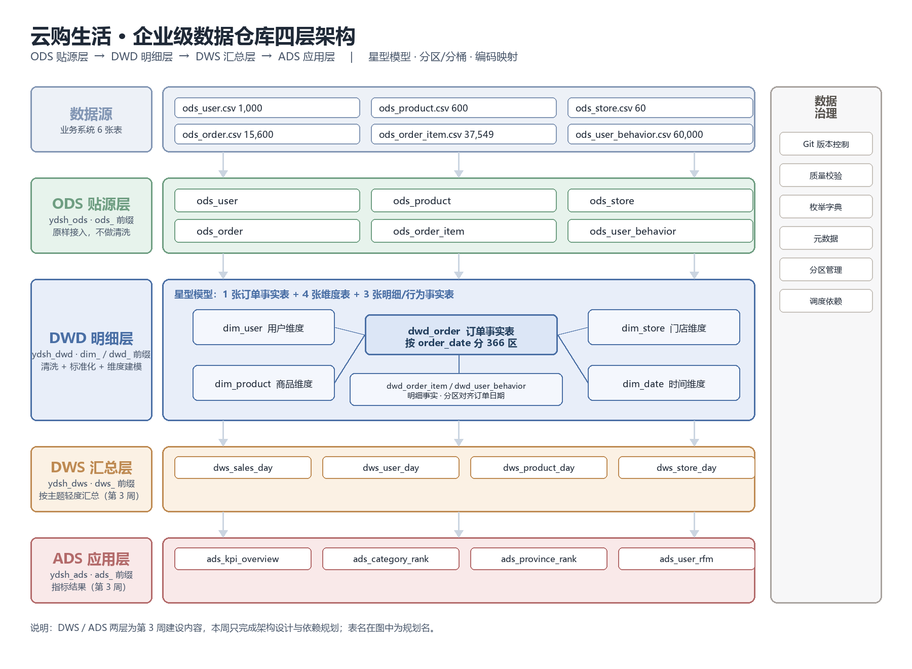
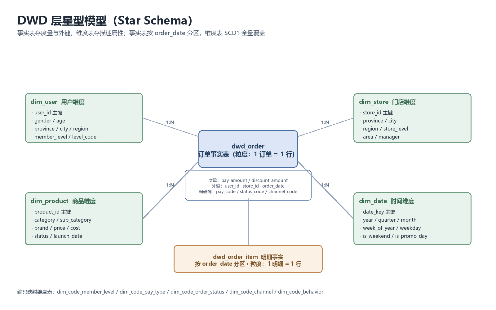

# 云购生活 · 数据仓库架构设计文档

> 项目：企业级数据仓库与经营分析可视化系统
> 周次：第 2 周 · 子任务 5（四层数仓架构设计）+ 子任务 6（DWD 维度建模）
> 作者：梁常金　|　修订：2026-11-02

---

## 1. 文档目的

本文档回答三个问题：

1. **数据怎么流**——从业务系统的 CSV 到报表指标，中间经过几层、每层做什么；
2. **表怎么建**——每层的命名规范、粒度定义、主键/外键、分区与存储策略；
3. **为什么这么设计**——每一个关键选择（分区键、编码表、分桶、清洗位置）都给出取舍理由和代价。

第 3 周要在本架构上继续建设 DWS / ADS 两层，因此本文档同时也是第 3 周的施工图。

---

## 2. 架构总览



数据自下而上单向流动，四层的核心差异在于**抽象层级**：

| 层级 | 定位 | 回答什么问题 | 数据粒度 | 保留时长 |
|---|---|---|---|---|
| ODS 贴源层 | 原样接入 | "系统里当时到底存了什么" | 与源系统完全一致 | 全量留痕，不删不改 |
| DWD 明细层 | 清洗 + 标准化 + 建模 | "这一单是谁、在哪、买了什么、花了多少" | 明细事实（1 订单/1 明细/1 行为） | 全量 |
| DWS 汇总层 | 按主题轻度汇总 | "某天/某品类/某门店卖了多少" | 日粒度 + 维度组合 | 可回算，按需保留 |
| ADS 应用层 | 面向指标与报表 | "老板要看的那 20 个数字" | 指标级结果 | 按报表周期 |

一句话概括分层价值：**ODS 保真、DWD 保质、DWS 保快、ADS 保用**。

---

## 3. 各层设计

### 3.1 ODS 贴源层（ydsh_ods）

- **原则**：字段名、字段类型、字段顺序与 CSV 完全一致，**不做任何清洗**。
- **为什么要求"脏"**：本周的核心交付物是《数据质量清洗报告》，需要统计"清洗前 vs 清洗后"。如果 ODS 层提前把脏值改掉，修复率就无从计算。ODS 是唯一能证明"原始数据有多脏"的证据。
- **实现细节**：
  - 日期、时间字段统一用 `STRING` 承接。源数据存在 `2024-07-26` / `2024/07/26` / `20240726` 三种写法，直接定义成 `DATE` 会让整行变 `NULL`（Hive 的类型转换失败不报错，静默变 NULL，这是最隐蔽的坑）。
  - `TBLPROPERTIES('skip.header.line.count'='1')` 跳过 CSV 表头，否则表头会被当成一条数据。
  - 存储用 `TEXTFILE`，与源文件同格式，便于人工比对。

| 表名 | 行数 | 说明 |
|---|---|---|
| ods_user | 1,000 | 用户信息 |
| ods_product | 600 | 商品信息 |
| ods_store | 60 | 门店信息 |
| ods_order | 15,600 | 订单主表（含 600 行重复） |
| ods_order_item | 37,549 | 订单明细 |
| ods_user_behavior | 60,000 | 用户行为日志 |

### 3.2 DWD 明细层（ydsh_dwd）

本层的三件事：**清洗**（脏值修正）、**标准化**（枚举/格式统一）、**建模**（星型模型）。

#### 3.2.1 建模方法

采用 Kimball 维度建模的星型模型，以**订单事实表为中心**，四张维度表环绕：



**事实表与维度表的划分依据**（答辩常被问）：

- 事实表 = 业务过程 + 外键 + **可加度量**。`pay_amount`、`quantity` 可以按任意维度求和，是度量。
- 维度表 = 描述性属性。`gender`、`category`、`store_level` 是"看数据的角度"，不是"算数的对象"。

**粒度声明**（每张事实表必须写死，否则会被重复聚合）：

| 事实表 | 粒度 | 一行代表 |
|---|---|---|
| dwd_order | 订单 | 一次下单行为 |
| dwd_order_item | 订单明细 | 一个订单里的一个商品行 |
| dwd_user_behavior | 行为 | 一次 pv/cart/fav/buy |

#### 3.2.2 编码映射维度表

订单状态、支付方式、会员等级、渠道、行为类型五个字段，源系统存在"中文/英文/大小写/数字码"混写。处理方式不是把 `case when` 写死在 ETL 里，而是拆成 **编码映射维度表**：

| 表名 | 行数 | 作用 |
|---|---|---|
| dim_code_member_level | 4 | 会员等级 编码 ↔ 中文名 ↔ 等级序号 |
| dim_code_pay_type | 4 | 支付方式 编码 ↔ 中文名 ↔ 是否线上 |
| dim_code_order_status | 5 | 订单状态 编码 ↔ 中文名 ↔ 是否已付/是否终态 |
| dim_code_channel | 4 | 渠道 编码 ↔ 中文名 ↔ 是否线上 |
| dim_code_behavior | 4 | 行为类型 编码 ↔ 中文名 ↔ 漏斗层级 |
| dim_enum_map | 68 | 全部脏写法 → 规范值 的字典（含大小写变体、空串） |

**为什么值得多建 6 张表**：

1. **可维护**：业务新增"云闪付"，只需 `INSERT` 一行，不用改 ETL SQL、不用回归测试。
2. **可发现**：ETL 用 `LEFT JOIN` 关联编码表，映射缺失会直接暴露成 `NULL`；而 `case when ... else '其他'` 会把脏值悄悄吞掉，问题被藏起来。
3. **可复用**：DWS/ADS 层按 `status_code` 聚合，比按中文字符串聚合稳定（不怕文案改字）。

DWD 事实表里同时保留**中文名**（给人看、给 BI 直接用）和**编码**（给机器聚合），冗余但各有用途。

#### 3.2.3 分区策略

| 表 | 分区键 | 分区数 | 理由 |
|---|---|---|---|
| dwd_order | order_date | 366 | 90% 的查询都带日期范围，分区裁剪收益最大 |
| dwd_order_item | order_date | 366 | 与订单表**分区对齐**，两表 JOIN 时都只扫一个分区 |
| dwd_user_behavior | behavior_date | 92 | 行为日志实际只覆盖 2024-10-01 ~ 12-31 |
| 四张维度表 | 无分区 | — | 维度表只有 60~1000 行，分区反而增加小文件 |

**为什么按天而不是按月**：按月分区只有 12 个分区，单分区 1250 行，查询"某一天"仍要扫整月；按天分区后单分区约 40 行，裁剪更彻底。代价是 366 个小文件——在 1.5 万行这个量级下，小文件开销远小于全表扫描的浪费，因此按天是对的。真实量级（每天百万行）时两者都合理，通常按天 + 定期合并小文件。

**分区字段不进列清单**：Hive 的分区列是目录名，`dwd_order` 的列清单里没有 `order_date`，但可以直接 `SELECT order_date`，也可以 `WHERE order_date='2024-07-26'`。

#### 3.2.4 分桶策略

`dwd_order_bucketed` 按 `user_id` 哈希分 8 桶，用于验证 Map-Side Join：

- 两表按同一键、同一桶数分桶后，JOIN 可以在 Map 端完成（桶对桶），省掉 Reduce 端 Shuffle。
- 桶数取 2 的幂、且远小于"数据量/块大小"，8 桶下每个桶文件约 1600~2300 行，分布均匀。
- 实测：15000 行订单自连接产生 240,908 行结果，join 正常；8 个桶文件行数 1611~2283，哈希散列效果良好。

**本项目数据量下分桶没有性能收益**（数据太小，Shuffle 本来就是秒级），所以只做技术验证，不虚构性能数字。这一点在答辩时要主动说清楚——把"能用"和"有用"分开讲，比硬吹性能更可信。

### 3.3 DWS 汇总层（ydsh_dws，第 3 周建设）

规划四张主题汇总表，粒度为"日 + 维度组合"：

| 表名（规划） | 粒度 | 主要度量 |
|---|---|---|
| dws_sales_day | 日 × 品类 | GMV、订单数、件数、客单价 |
| dws_user_day | 日 × 用户 | 消费额、订单数、活跃行为数 |
| dws_product_day | 日 × 商品 | 销量、销售额、动销率 |
| dws_store_day | 日 × 门店 | GMV、客流、坪效 |

### 3.4 ADS 应用层（ydsh_ads，第 3 周建设）

面向报表与看板的宽表，一行一个指标或一个排名项，直接对接 Superset / ECharts：

| 表名（规划） | 用途 |
|---|---|
| ads_kpi_overview | 核心 KPI 总览（GMV/订单/用户/客单价） |
| ads_category_rank | 品类销售排行 |
| ads_province_rank | 省份销售排行 |
| ads_user_rfm | 用户 RFM 分层 |

---

## 4. 命名规范

统一规范是评审硬指标，本项目严格遵守：

| 对象 | 规范 | 示例 |
|---|---|---|
| 数据库 | `ydsh_` + 层名 | `ydsh_ods` / `ydsh_dwd` / `ydsh_dws` / `ydsh_ads` |
| 贴源表 | `ods_` + 业务实体 | `ods_order` |
| 维度表 | `dim_` + 实体 | `dim_user` / `dim_product` / `dim_date` |
| 编码维度表 | `dim_code_` + 实体 | `dim_code_pay_type` |
| 事实表 | `dwd_` + 业务过程 | `dwd_order` / `dwd_order_item` |
| 汇总表 | `dws_` + 主题 + 周期 | `dws_sales_day` |
| 应用表 | `ads_` + 指标 | `ads_kpi_overview` |
| 清洗标记列 | 字段名 + `_flag` / `_is_xxx` | `amount_flag` / `age_is_filled` |
| 原始值备份列 | 字段名 + `_raw` | `pay_amount_raw` / `quantity_raw` |
| 分区字段 | `order_date` / `behavior_date` | 与业务日期同名，不用 `dt`（`dt` 看不出是哪张表的时间） |
| 字段命名 | 小写下划线，不用拼音、不用中文 | `member_level` 而不是 `hy_dj` |

**原始值备份列的意义**：所有被修正过的度量都保留 `_raw` 原值。数据治理最基本的要求是"改得动、也改得回来"，出问题时能立刻回答"这条记录原本是多少、被谁改成了多少"。

---

## 5. 数据流向与依赖

```
CSV 文件 (data/*.csv)
   │  LOAD DATA LOCAL INPATH
   ▼
ods_* ─────────────────────────────────────────────┐
   │ 清洗：枚举/格式/异常/去重                        │
   ▼                                                │
dim_code_* (静态编码表，先建)                        │
dim_user / dim_product / dim_store                  │
dim_date (一次性生成 366 天)                         │
   │                                                │
   ▼                                                │
dwd_order  ←── 依赖 dim_code_*                      │
   │                                                │
   ├──► dwd_order_item ←── 依赖 dwd_order（取分区日期）│
   └──► dwd_user_behavior ←── 依赖 dim_code_behavior │
                                                    │
   ▼                                                │
DWS（第 3 周） ──► ADS（第 3 周） ──► Superset / ECharts
```

**执行顺序不能乱**：`dwd_order_item` 的分区键来自 `dwd_order`，必须等订单表装载完成；编码表必须先建，否则 ETL 关联出 `NULL`。完整执行顺序写在 `sql/` 目录的脚本编号里（`00` → `01` → `02` … `08`）。

---

## 6. 表清单（DWD 层现状）

| 表名 | 类型 | 行数 | 存储 | 分区 | 说明 |
|---|---|---|---|---|---|
| dim_user | 维度 | 1,000 | ORC | — | 用户维度，枚举+年龄+日期+手机号已标准化 |
| dim_product | 维度 | 600 | ORC | — | 商品维度，价格异常已修正 |
| dim_store | 维度 | 60 | ORC | — | 门店维度，含 area 派生的 store_level |
| dim_date | 维度 | 366 | ORC | — | 2024 全年时间维度 |
| dim_code_member_level | 编码维度 | 4 | ORC | — | — |
| dim_code_pay_type | 编码维度 | 4 | ORC | — | — |
| dim_code_order_status | 编码维度 | 5 | ORC | — | — |
| dim_code_channel | 编码维度 | 4 | ORC | — | — |
| dim_code_behavior | 编码维度 | 4 | ORC | — | — |
| dim_enum_map | 字典 | 68 | ORC | — | 枚举脏写法映射字典 |
| dwd_order | 事实 | 15,000 | ORC | 366 | 订单，已去重 |
| dwd_order_item | 事实 | 37,163 | ORC | 366 | 明细，剔除 0 数量 |
| dwd_user_behavior | 事实 | 60,000 | ORC | 92 | 行为日志 |
| dwd_order_bucketed | 事实（分桶） | 15,000 | ORC 8 桶 | — | Map-Side Join 验证 |
| dq_enum_scan | 质量 | 105 | ORC | — | 枚举值域扫描（before/after） |
| dq_compare | 质量 | 23 | ORC | — | 五类脏数据修复率对比 |

---

## 7. 关键设计决策与取舍

| 决策点 | 选择 | 放弃的方案 | 理由 |
|---|---|---|---|
| 清洗放在哪层 | DWD | ODS（贴源层就洗干净） | ODS 必须保真，否则修复率无法统计，也无法回溯"原始长什么样" |
| 维度表历史 | SCD1 全量覆盖 | SCD2 拉链表 | 用户等级变化不影响历史订单归因（订单当时的价格/等级已固化在事实表），SCD2 的复杂度换不来收益 |
| 状态编码语义 | 按生命周期假设映射 | 保留数字码不映射 | 数字码对业务不可读；假设写进文档和映射表，业务确认真实字典后改 4 行数据即可 |
| 明细表分区 | 跟随订单日期 | 按明细自身日期 | 明细本身无独立日期，跟随订单日期才能与订单表分区对齐 |
| 分桶 | 8 桶按 user_id | 不建分桶表 | 用于验证 Map-Side Join 可行性，规模小无收益，如实说明 |
| 维度表存储 | ORC | PARQUET | 两者都列式，ORC 在 Hive 生态压缩比更好、谓词下推支持更完整 |
| 金额超限处理 | 门店中位数替换 | 删除整行 | 删单会丢 GMV；替换后保留 `_raw` 可回溯，副作用可控 |

---

## 8. 已知局限与后续改进

1. **DWS/ADS 未建设**：第 3 周完成，本架构已为其预留粒度与命名。
2. **无调度系统**：当前靠脚本编号 + 手工顺序执行。真实项目应上 Airflow / DolphinScheduler 做依赖编排。
3. **无增量抽取**：全部为全量覆盖（`INSERT OVERWRITE`）。数据量增长后需改为按分区增量（`INSERT INTO ... PARTITION`）。
4. **维度表无版本**：SCD1 覆盖会丢失历史。若后续需要"用户去年是什么等级"的分析，需升级为 SCD2。
5. **小文件问题**：366 个分区各 1 个文件，长期跑批会产生大量小文件，需定期 `ALTER TABLE ... CONCATENATE` 或改用 `hive.merge` 参数。

---

## 9. 附：相关脚本索引

| 脚本 | 作用 |
|---|---|
| `sql/dwd/00_ddl_dwd.sql` | DWD 层全部 DDL（维度/事实/分区/分桶） |
| `sql/dwd/02_partition_bucket.sql` | 分区裁剪 + 分桶 + Map-Side Join 验证 |
| `sql/clean/01_enum_map_seed.sql` | 枚举规范字典 + 清洗前值域扫描 |
| `sql/clean/02_clean_dim_user.sql` | 用户维度清洗装载 |
| `sql/clean/03_clean_dim_product.sql` | 商品维度清洗装载 |
| `sql/clean/04_clean_dim_store.sql` | 门店维度清洗装载 |
| `sql/clean/05_clean_order_fact.sql` | 订单事实表清洗装载（去重/枚举/金额/时间戳/分区） |
| `sql/clean/06_clean_item_fact.sql` | 明细事实表清洗装载 |
| `sql/clean/07_clean_behavior_fact.sql` | 行为事实表清洗装载 |
| `sql/clean/08_verify_after_clean.sql` | 清洗后全面校验（值域/行数/格式/异常/外键） |
| `sql/quality/dq_compare_week2.sql` | 五类脏数据修复率对比 |
| `sql/analysis/eda_week2.sql` | 探索性分析全部查询 |
