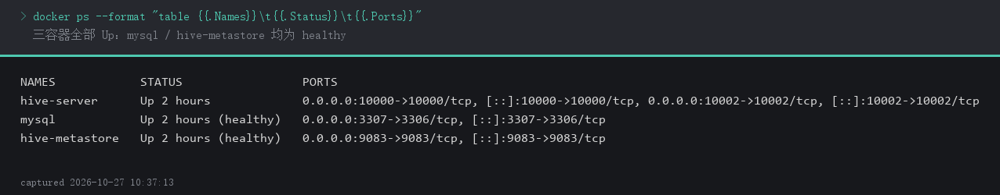
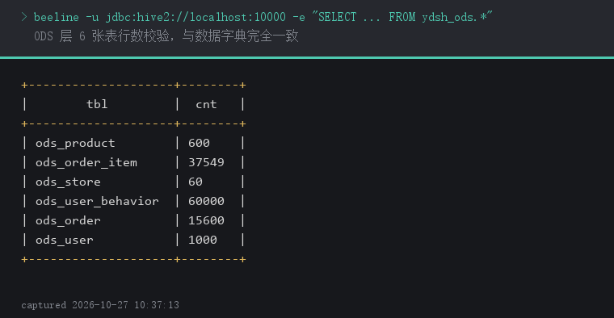
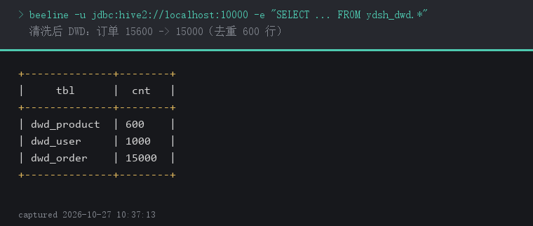
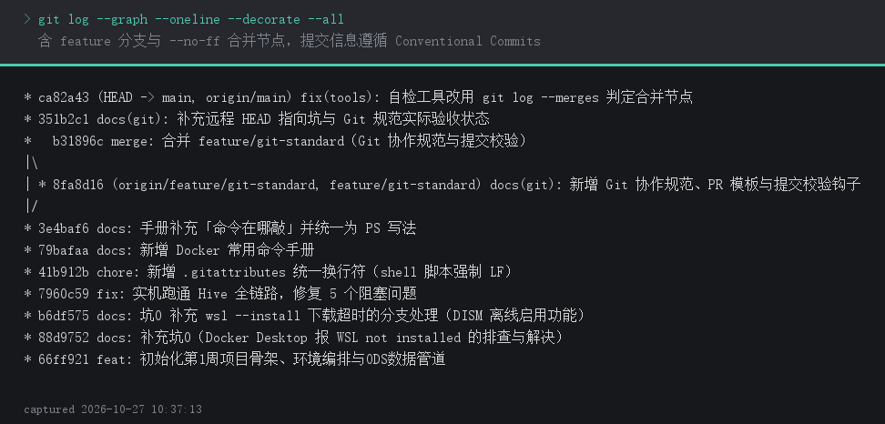

# 环境搭建笔记

> 交付物 #2｜第 1 周子任务 2
> 记录人：梁常金　记录时间：2026-10-27
> 说明：本文档只记"**踩过的坑 + 怎么解决的**"，不抄安装教程。
> 答辩时老师问"环境搭建遇到什么问题"，直接翻这里。

---

## 一、环境信息

| 项 | 值 |
|---|---|
| 操作系统 | Windows 11 家庭版 中文版（Build 26200） |
| CPU / 内存 | 18 核 / 31.6 GB |
| Docker Desktop 版本 | 4.96.3（Engine 29.9.2） |
| WSL 版本 | WSL 2（Docker Desktop 内置 docker-desktop 发行版） |
| 磁盘可用空间 | 129.1 GB（C 盘） |

### 服务与端口清单

| 服务 | 容器名 | 端口 | 用途 | 验证命令 |
|---|---|---|---|---|
| MySQL 8.0 | mysql | 3307（宿主）→ 3306（容器） | Metastore 元数据库 | `docker exec -it mysql mysql -uroot -proot -e "show databases;"` |
| Hive Metastore | hive-metastore | 9083 | 元数据 thrift 服务 | `docker logs hive-metastore \| grep -i started` |
| HiveServer2 | hive-server | 10000 | beeline / JDBC | `docker exec -it hive-server beeline -u 'jdbc:hive2://localhost:10000/'` |
| HiveServer2 Web | hive-server | 10002 | Web UI | 浏览器 http://localhost:10002 |

---

## 二、启动流程（每次开机后照做）

```powershell
# 0) 先确认 Docker Desktop 已经启动（托盘图标为绿色/运行中），否则所有命令都会
#    报 "error during connect: ... The system cannot find the file specified"
docker version

# 1) 进入项目根目录
cd C:\Users\Lenovo\Desktop\ydsh-dw

# 2) 首次启动需要 --build（构建带 MySQL 驱动的 Hive 镜像），之后可省略
docker compose up -d --build

# 3) 等待 60~90 秒，确认三个容器都是 Up（不是 Restarting / Exited）
docker ps --format "table {{.Names}}\t{{.Status}}\t{{.Ports}}"

# 4) 连接 Hive 验证
docker exec -it hive-server beeline -u "jdbc:hive2://localhost:10000/"
# 进入后依次执行：
#   show databases;
#   create database if not exists ydsh_ods;
#   exit;
```

**验证通过标准**：`docker ps` 三个容器均 `Up`；beeline 能进入交互界面且 `show databases;` 返回 `default`。

---

## 三、踩坑记录

本节按搭建时间顺序记录实际遇到的问题，每个坑统一按「现象 → 原因 / 诊断 → 解决 → 验证」四段组织；带 ★ 的为耗时最长、最容易卡住环境的关键坑，答辩时优先讲这几个。

### 坑 0｜Docker Desktop 装完起不来：WSL not installed ★装环境第一关

**现象**

安装 Docker Desktop 后启动，弹出红色提示：

```
Docker Desktop - WSL not installed
Windows Subsystem for Linux (WSL) is not installed.
Install it by running wsl --install in an administrative PowerShell,
then restart your computer.
wsl is not installed
```

注意：此时 `C:\Windows\System32\wsl.exe` **文件是存在的**，但只要执行就报"wsl is not installed"。
原因是这个 exe 只是入口程序，背后依赖的系统功能（`Microsoft-Windows-Subsystem-Linux`）没有启用，
对应的 `LxssManager` 服务在系统里根本不存在。

**诊断方法**（普通 PowerShell 即可，不需要管理员）
```powershell
Get-Service -Name LxssManager -ErrorAction SilentlyContinue   # 无任何输出 = 未启用
(Get-CimInstance Win32_ComputerSystem).HypervisorPresent       # True = 底层虚拟化正常
```
若 `LxssManager` 查不到、但 `vmcompute` / `hns` 服务是 Running，说明只是缺 WSL 功能，不用管 BIOS 虚拟化开关。

**解决步骤**

第一步，以管理员身份打开 PowerShell（Win + X → "终端(管理员)"），执行：
```powershell
wsl --install --no-distribution
```
`--no-distribution` 表示只装 WSL 组件、不附带 Ubuntu，因为 Docker Desktop 会自建
`docker-desktop` 发行版，多装一个 Ubuntu 纯属浪费 500 MB 磁盘。

若你的 WSL 版本较旧、不认这个参数，退回执行（会顺带装 Ubuntu，可接受）：
```powershell
wsl --install
```

第二步，**必须重启电脑**。只装不重启，Docker Desktop 依然报同样的错。

第三步，重启后验证：
```powershell
wsl --status          # 应显示 默认版本: 2
wsl --update          # 如提示需要更新内核则执行
```

第四步，重新启动 Docker Desktop，等左下角变绿 `Engine running`。

**若 `wsl --install` 本身报错**（例如系统精简版 / 组策略禁用商店），改用 DISM 手动启用功能，
在管理员 PowerShell 中执行后重启：
```powershell
dism.exe /online /enable-feature /featurename:Microsoft-Windows-Subsystem-Linux /all /norestart
dism.exe /online /enable-feature /featurename:VirtualMachinePlatform /all /norestart
```
重启后再执行一次 `wsl --update` 补内核。

#### 坑 0 的分支｜下载到一半提示"操作超时"

**现象**
```
正在下载: 适用于 Linux 的 Windows 子系统 3.0.3
操作超时
```
命令直接返回提示符，WSL 并没有装上。

**原因**：`wsl --install` 内置超时较短，而它要拉的是 360 MB 左右的商店安装包。
国内直连微软 CDN 通常只有 100～300 KB/s，十几秒就会触发超时；GitHub Release 的下载域名
（`objects.githubusercontent.com`）很多网络下直接 502。实测：`wslstorestorage.blob.core.windows.net`
可用但约 300 KB/s，`ghfast.top` / `ghproxy.net` 约 100～170 KB/s，完整包要 30 分钟以上。

**正确做法：先启用系统功能（本地文件，不下载），重启后再判断是否真的还需要那个包**
```powershell
dism.exe /online /enable-feature /featurename:Microsoft-Windows-Subsystem-Linux /all /norestart
dism.exe /online /enable-feature /featurename:VirtualMachinePlatform /all /norestart
```
两条命令都提示"操作成功完成"后重启电脑，然后看 `wsl --status`：
- 若已显示 `默认版本: 2` → WSL 2 可用，直接去启动 Docker Desktop，不必再下载；
- 若仍提示 WSL 未安装 → 再执行 `wsl --install --no-distribution`；若继续超时，就
  手动下载 `wsl.3.0.3.0.x64.msi`（GitHub Releases 页）双击安装，装完重启。

**判断依据**：`Get-Service LxssManager` 有输出 = 功能已启用；无任何输出 = 功能未启用（与下载无关）。

**验证通过标准**：`wsl --status` 显示默认版本 2，且 Docker Desktop 托盘图标为绿色、`docker info` 能输出版本号。

---

### 坑 1｜Metastore 起不来：找不到 MySQL 驱动 ★最常见

**现象**
```
docker logs hive-metastore
... java.sql.SQLException: No suitable driver found for jdbc:mysql://mysql:3306/metastore
... Unable to initialize JDO
容器状态反复 Restarting
```

**原因**：`apache/hive` 官方镜像**不内置**任何数据库 JDBC 驱动（PostgreSQL / MySQL 都没有）。
很多教程直接 `docker run apache/hive:4.0.0` 配 `DB_DRIVER=mysql`，必然失败。

**解决**：本项目用 `Dockerfile.hive` 多阶段构建，把 `mysql-connector-j` 打进镜像，
`docker compose up -d --build` 时会自动完成下载与打包，无需手动找 jar。

> 如果构建阶段报网络错误（公司网络/校园网限制），把 `Dockerfile.hive` 里的下载地址
> 换成国内镜像，或手动下载 jar 后放到 `lib/` 并改用 volume 挂载：
> ```yaml
> volumes:
>   - ./lib/mysql-connector-j.jar:/opt/hive/lib/mysql-connector-j.jar
> ```

---

### 坑 2｜`LOAD DATA LOCAL INPATH` 报 File does not exist

**现象**
```
FAILED: SemanticException Line 1:23 Invalid path ''/data/ods_user.csv'': No files matching path file:/data/ods_user.csv
```

**原因**：CSV 在**宿主机**上，容器里看不到宿主机任意路径。
`LOCAL` 指的是"执行 Hive 的那台机器的本地文件系统"，而容器是一个隔离环境。

**解决**：`docker-compose.yml` 已把 `./data` 挂载到容器内 `/data`：
```yaml
volumes:
  - ./data:/data:ro
```
因此：
- 文件必须放在项目的 `data/` 目录下；
- `LOAD DATA LOCAL INPATH` 要写**容器内路径** `/data/ods_user.csv`，
  不能写 `D:/xxx/data/ods_user.csv`；
- 执行 beeline 时也应在**容器内**执行（`docker exec -it hive-server beeline ...`），
  不要在宿主机装 beeline 后远程连，否则 LOCAL 语义又会绕晕。

---

### 坑 3｜导入后行数比预期多 1

**现象**：`select count(*) from ods_order;` 返回 15601，预期 15600。

**原因**：CSV 首行是表头，被当成一条数据导进去了。

**解决**：建表时加
```sql
TBLPROPERTIES ('skip.header.line.count' = '1');
```
也可以事后 `ALTER TABLE ... SET TBLPROPERTIES ('skip.header.line.count'='1');` 再重新 `OVERWRITE` 导入。

> **额外注意**：本项目 CSV 带 UTF-8 BOM（文件开头有 `\ufeff`）。
> 因为 BOM 只出现在表头那一行，跳过表头后 BOM 也一并被跳过，所以不影响；
> 但如果哪天不跳表头，第一列会变成 `\ufeffuser_id`，`select user_id` 就会报"字段不存在"。

---

### 坑 4｜10000 端口被占用

**现象**：`Error starting userland proxy: listen tcp4 0.0.0.0:10000: bind: address already in use`

**排查**
```powershell
netstat -ano | findstr :10000
tasklist | findstr <上一步查到的PID>
```
**解决**：关掉占用进程，或改 `docker-compose.yml` 的端口映射，例如 `"10001:10000"`，
之后 beeline 连 `jdbc:hive2://localhost:10001/`。

> Hive 元数据库 MySQL 的 3306 也常被本机已装的 MySQL 占用，同理处理。

---

### 坑 5｜容器 Up 但 beeline 连不上

**现象**：`Could not open client transport with JDBC Uri: jdbc:hive2://localhost:10000/: Connection refused`

**原因**：HiveServer2 启动比 Metastore 慢，`docker ps` 显示 Up 只代表进程活着，
不代表 10000 端口已经 listen。冷启动通常需要 40~90 秒。

**解决**：等，并看日志确认：
```powershell
docker logs -f hive-server
# 出现 "HiveServer2 started" / "Service listening on port 10000" 再连
```

---

### 坑 6｜Windows 下 docker compose 命令不存在

**现象**：`docker: 'compose' is not a docker command`

**原因**：装的是旧版 docker-compose（v1）或 Docker Desktop 版本过旧。

**解决**：Docker Desktop ≥ 3.4 自带 Compose V2，用 `docker compose`（中间是空格，不是连字符）。
若只有 `docker-compose`，升级 Docker Desktop。

---

### 坑 7｜中文乱码 / 中文注释报错

**现象**：`show tables` 后中文注释显示为 `???`，或建表语句里中文 COMMENT 报编码错误。

**解决**
1. beeline 连接时指定编码：`beeline -u "jdbc:hive2://localhost:10000/;?useUnicode=true&characterEncoding=UTF-8"`
2. 确保 `.sql` 文件本身存为 UTF-8（无 BOM 更稳妥）；
3. Windows 终端建议用 PowerShell 7 或 Windows Terminal，并 `chcp 65001`。

---

### 坑 8｜`docker compose down` 后数据全没了

**原因**：用了 `docker compose down -v`，`-v` 会连 named volume 一起删，元数据与仓库文件全丢。

**记住**
| 命令 | 效果 |
|---|---|
| `docker compose stop` | 停容器，数据保留 |
| `docker compose down` | 删容器，数据保留（volume 还在） |
| `docker compose down -v` | **删容器 + 删数据**，等同于重装 |
| `docker compose down --rmi all -v` | 连镜像一起删 |

> 项目里 `sql/` 脚本是幂等的（`DROP TABLE IF EXISTS` + `CREATE ... AS`），
> 万一数据丢了，重跑 `docker compose up -d` → `run_all` 三步就能恢复。

---

### 坑 9｜宽表 UNION ALL 执行失败：Too many counters ★实机首次必踩

**现象**
```
ERROR : FAILED: Execution Error, return code 2 from org.apache.hadoop.hive.ql.exec.tez.TezTask.
        Counters limit exceeded: Too many counters: 121 max=120
```

**原因**：Hive 4 默认用 Tez 引擎，Tez 对单个 DAG 的计数器 key 数量限制为 **120**。
数据质量扫描脚本要一次查几十个字段（每个字段的 NULL 统计都产生计数器），很容易超。

**为什么 `--hiveconf` 不管用**
```powershell
# 这样写无效，仍然是 121 max=120
beeline --hiveconf tez.am.counters.max.keys=5000 ...
```
Hive 不会把 `tez.` 前缀的配置转发给 Tez AM，必须在 Tez 侧的 `tez-site.xml` 里定义。
另外 `hive.tez.counters.max.keys` 这个 key 在 Hive 4 **不存在**，乱加会直接连不上：
`hive configuration hive.tez.counters.max.keys does not exists`。

**解决**（本项目已内置，见 `conf/tez-site.xml`）
1. 在项目里建 `conf/tez-site.xml`，写入 `tez.am.counters.max.keys=5000`、
   `tez.am.counters.max.groups=1000`；
2. 在 `docker-compose.yml` 的 `hive-server` 下挂载，**必须挂到 `/opt/hive/conf`**：
   ```yaml
   volumes:
     - ./conf/tez-site.xml:/opt/hive/conf/tez-site.xml:ro
     - ./conf/tez-site.xml:/opt/tez/conf/tez-site.xml:ro
   ```
   因为镜像的 `HADOOP_CLASSPATH` 是 `/opt/tez/*:/opt/tez/lib/*`，**不含** `/opt/tez/conf`；
   真正在 classpath 上的是 `HIVE_CONF_DIR=/opt/hive/conf`。
3. 重建容器生效：`docker compose up -d --force-recreate hive-server`
   （只 `docker restart` 会失败，见下一坑）

> **XML 注释里不能出现连续两个减号**。我第一次写配置文件时在注释里用了 `-----` 分隔线，
> 结果 Tez 初始化直接抛 `ExceptionInInitializerError` / `Could not initialize class TezConfigurationFactory`，
> 排查半天才发现是 XML 不合法。用 Python 一条命令就能验证：
> `python -c "import xml.etree.ElementTree as ET; ET.parse('conf/tez-site.xml')"`

---

### 坑 10｜`docker restart hive-server` 后容器起不来

**现象**：重启后容器立刻退出，日志末尾是
```
HiveServer2 running as process 7.  Stop it first.
```
**原因**：官方镜像的 entrypoint 会先检查是否已有 HiveServer2 进程（PID 文件仍在），
检测到就拒绝启动。这是镜像脚本的设计，不是配置错误。

**解决**：用重建代替重启
```powershell
docker compose up -d --force-recreate hive-server
```

---

### 坑 11｜Git Bash 里执行 SQL 报 `No FileSystem for scheme "C"`

**现象**
```
docker exec -i hive-server beeline -u '...' -f /sql/ods/create_ods.sql
-> No FileSystem for scheme "C"
```
**原因**：Git Bash（MSYS）会把以 `/` 开头的参数当成路径，自动改写成
`C:/Program Files/Git/sql/ods/create_ods.sql`，容器里当然没有这个路径。

**解决**（三选一）
```bash
export MSYS_NO_PATHCONV=1          # 推荐，本项目 run_all.sh 已内置
# 或
docker exec -i hive-server beeline ... -f //sql/ods/create_ods.sql   # 双斜杠转义
```
PowerShell 和 CMD 没有这个问题，只有 Git Bash / MSYS 环境需要处理。

---

### 坑 12｜`SQL` 里用了 MySQL 函数：Invalid function IFNULL

**现象**
```
FAILED: SemanticException [Error 10011]: Invalid function IFNULL
```
**原因**：`IFNULL` 是 MySQL 的函数，Hive 里没有。写惯了 MySQL 很容易顺手打出来。

**Hive 对应写法**
| MySQL | Hive |
|---|---|
| `IFNULL(x, 0)` | `NVL(x, 0)` |
| `IFNULL(a, b)` | `COALESCE(a, b)` |
| `DATE_FORMAT(d,'%Y-%m')` | `DATE_FORMAT(d,'yyyy-MM')`（格式串不同！） |
| `GROUP_CONCAT(x)` | `CONCAT_WS(',', COLLECT_LIST(x))` |
| `` `col` `` 反引号 | 同样支持 |

---

### 坑 13｜中文别名报 ParseException

**现象**
```
FAILED: ParseException line 2:72 cannot recognize input near 'AS' ',' 'SUM' in selection target
```
**原因**：`SUM(x) AS 需删除行数` —— Hive 的标识符默认只认字母数字下划线，
中文别名必须显式加反引号，否则解析器在 `AS` 之后遇到中文就卡住，
报错位置还会指到后一个逗号，很容易误判。

**解决**
```sql
SELECT SUM(cnt - 1) AS `需删除行数` FROM ...   -- 加反引号即可
```
> 中文注释（`-- 注释`）和中文 `COMMENT '...'` 不受影响，只有**别名**需要反引号。

---

### 坑 14｜3306 端口被本机 MySQL80 占用

**现象**
```
Error response from daemon: ports are not available: exposing port TCP 0.0.0.0:3306:
listen tcp 0.0.0.0:3306: bind: Only one usage of each socket address is normally permitted.
```
**排查**
```powershell
Get-NetTCPConnection -LocalPort 3306 -State Listen | Select-Object OwningProcess
Get-Process -Id <PID>          # 通常是 mysqld，本机装了 MySQL 8 服务版
```
**解决**：本项目已把映射改成 `3307:3306`（容器内仍是 3306，Hive 连 `mysql:3306` 不受影响）。
从宿主机访问时记得用 3307：
```powershell
mysql -h 127.0.0.1 -P 3307 -uroot -proot
```
不建议去停本机的 MySQL80 服务 —— 那是别的课程/项目在用的。

---

## 四、环境自检清单（交付物 #1 的验收依据）

- [ ] `wsl --status` 显示默认版本 2（Docker Desktop 的 WSL 2 后端前提）
- [ ] Docker Desktop 托盘图标为绿色 `Engine running`
- [x] `docker version` 能输出版本号（Client 与 Server 都要有，只有 Client = 引擎没起来）
- [x] `docker compose version` 能输出版本号
- [x] `docker ps` 中 mysql / hive-metastore / hive-server 三个容器均 Up
- [x] `docker exec -it mysql mysql -uroot -proot -e "use metastore; show tables;"` 能看到 `TBLS` 等元数据表
- [x] beeline 能连接并执行 `show databases;`
- [x] `ydsh_ods`、`ydsh_dwd` 两个库已创建
- [x] `select count(*)` 六张表行数与预期一致（1000 / 600 / 60 / 15600 / 37549 / 60000）

### 实机验证记录（2026-10-27）

| 检查项 | 实测结果 |
|---|---|
| 引擎版本 | Docker Engine 29.9.2 / Docker Desktop 4.96.3（WSL 2 后端） |
| 元数据库初始化 | Metastore 日志出现 `Initialized schema successfully..` |
| 六表行数 | ods_user 1000 / ods_product 600 / ods_store 60 / ods_order 15600 / ods_order_item 37549 / ods_user_behavior 60000，全部 `OK` |
| 质量扫描 | 7 个结果集全部执行成功，无报错 |
| 清洗结果 | dwd_user 1000（年龄填充 78 条，异常值 0）、dwd_product 600（上架日期填充 11 条）、dwd_order 15000（重复 0 组） |
| 去重明细 | 586 组重复主键 = 388 组整行重复 + 198 组内容冲突，共删除 600 行 |

---

## 五、其他记录（团队自行补充）

| 日期 | 问题 | 现象 | 解决 | 耗时 |
|---|---|---|---|---|
| 2026-10-27 | WSL 未启用 | Docker Desktop 报 `WSL not installed` | DISM 启用两个功能后重启 | 约 30 分钟 |
| 2026-10-27 | Docker Hub 不可达 | `registry-1.docker.io` 超时 | 配 `registry-mirrors`（`docker.1panel.live`） | 约 40 分钟（含拉镜像 1.1GB） |
| 2026-10-27 | 3306 被占用 | 端口绑定失败 | 改映射 `3307:3306` | 5 分钟 |
| 2026-10-27 | Tez 计数器超限 | `Too many counters: 121 max=120` | 挂载 `conf/tez-site.xml` 到 `/opt/hive/conf` | 约 25 分钟 |
| 2026-10-27 | SQL 方言混用 | `Invalid function IFNULL` | 改 `NVL` | 5 分钟 |
| 2026-10-27 | 中文别名报错 | `ParseException near 'AS' ','` | 别名加反引号 | 5 分钟 |
| 2026-10-28 | 重启 Docker 后 HiveServer2 起不来 | 容器 `Exited (1)`，日志 `HiveServer2 running as process 7. Stop it first.` | 见下方专项说明，已在 compose 内置修复 | 约 20 分钟 |

**专项说明：重启 Docker Desktop 后 hive-server 无法启动（2026-10-28）**

- **现象**：`docker exec hive-server ...` 报 `container ... is not running`；`docker ps -a` 显示
  `hive-server  Exited (1)`，而 `mysql`、`hive-metastore` 均 `Up (healthy)`。
- **日志关键行**：
  ```
  HiveServer2 running as process 7.  Stop it first.
  ```
- **根本原因**（不是配置错误，是镜像的一个坑）：
  1. 镜像入口脚本启动 HiveServer2 时会把进程号写入 `/opt/hive/conf/hiveserver2.pid`；
  2. 该文件位于**容器可写层**，`docker stop` / Docker Desktop 重启后再 `start` 并不会清掉它；
  3. 重启后新容器的入口 `sh -c /entrypoint.sh` **恰好也是 PID 7**，与残留文件里的旧 PID 撞号；
  4. 入口脚本判定"7 号进程还活着 → 服务已在运行"，于是拒绝启动并退出 1。
- **验证是否这个原因**：`docker logs hive-server | tail -5` 只要出现 `Stop it first` 且 PID 与
  `ps -ef` 里 PID 1 的子进程号一致，即可确认。
- **两种处理**：
  - 临时（数据不丢，`warehouse` 是命名卷）：`docker compose up -d --force-recreate hive-server`
  - 根治（已写入 `docker-compose.yml`）：在 entrypoint 前清除残留 pid 文件
    ```yaml
    entrypoint: ["sh", "-c", "rm -f /opt/hive/conf/hiveserver2.pid && exec /entrypoint.sh"]
    restart: unless-stopped
    ```
    `exec` 不可省略，否则 `/entrypoint.sh` 不再是 PID 1，`docker stop` 的信号收不到、日志也会错位。
- **验证方式**：`docker restart hive-server` 后 `docker ps` 应保持 `Up`，
  且 `docker logs hive-server | grep -c "Stop it first"` 返回 0。
- **为什么敢重建容器**：数据都在命名卷里 —— `warehouse:/opt/hive/data/warehouse`（表数据）、
  `mysql_data:/var/lib/mysql`（元数据）。`--force-recreate` 只重建容器外壳，不动卷。
  这也是当初设计 compose 时把 warehouse 单独抽成命名卷的价值所在。

---

## 六、关键截图（实机）

> 以下截图均由本机实际执行的命令输出生成，采集时间 2026-10-27。
> 图中命令与数字可按下表命令原样复现。

### 6.1 三个容器全部 Up

复现命令：`docker ps --format "table {{.Names}}\t{{.Status}}\t{{.Ports}}"`



要点：`mysql` 与 `hive-metastore` 显示 `(healthy)`，`hive-server` 显示 `Up`；端口 3307/9083/10000/10002 均已绑定。

### 6.2 ODS 六表行数校验

复现命令（PowerShell 或 Git Bash 均可，整条复制一次执行）：

```bash
docker exec hive-server beeline -u jdbc:hive2://localhost:10000 --silent=true -e "SELECT 'ods_user' AS tbl, COUNT(*) AS cnt FROM ydsh_ods.ods_user UNION ALL SELECT 'ods_product', COUNT(*) FROM ydsh_ods.ods_product UNION ALL SELECT 'ods_store', COUNT(*) FROM ydsh_ods.ods_store UNION ALL SELECT 'ods_order', COUNT(*) FROM ydsh_ods.ods_order UNION ALL SELECT 'ods_order_item', COUNT(*) FROM ydsh_ods.ods_order_item UNION ALL SELECT 'ods_user_behavior', COUNT(*) FROM ydsh_ods.ods_user_behavior;"
```



要点：1000 / 600 / 60 / 15600 / 37549 / 60000，与《模拟数据字典》完全一致。末尾若出现一行 `No such file or directory`，是 beeline 找不到历史命令文件的无害提示，不影响查询结果。

### 6.3 清洗后 DWD 行数

复现命令：

```bash
docker exec hive-server beeline -u jdbc:hive2://localhost:10000 --silent=true -e "SELECT 'dwd_user' AS tbl, COUNT(*) AS cnt FROM ydsh_dwd.dwd_user UNION ALL SELECT 'dwd_product', COUNT(*) FROM ydsh_dwd.dwd_product UNION ALL SELECT 'dwd_order', COUNT(*) FROM ydsh_dwd.dwd_order;"
```



要点：`dwd_order` 由 15,600 降为 **15,000**（去重 600 行），`dwd_user`、`dwd_product` 不删行。

### 6.4 Git 提交历史

复现命令：`git log --graph --oneline --decorate --all`



要点：可见 `feature/git-standard` 分支与 `--no-ff` 合并节点，提交信息全部遵循 Conventional Commits。

