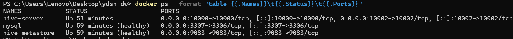

# 第 2 周动手操作指南

> 用途：按顺序执行即可完整复现第 2 周所有交付物；每一步都给出**预期输出**，对不上就说明这一步没做对。
> 环境：Windows 11 + Docker Desktop + Hive 4.0.0（容器 `hive-server`）
> 作者：梁常金　|　更新：2026-11-02

---

## 0. 前置检查（30 秒）

```bash
cd ~/Desktop/ydsh-dw
docker compose up -d
docker ps --format "table {{.Names}}\t{{.Status}}"
```

**预期**：`mysql (healthy)`、`hive-metastore (healthy)`、`hive-server Up`。



```bash
docker exec hive-server beeline -u "jdbc:hive2://localhost:10000" -n root --silent=true \
  -e "show databases;"
```

**预期**：列出 `ydsh_ods`、`ydsh_dwd`（若已跑过本周脚本，还有 `ydsh_dws`、`ydsh_ads`）。

> ⚠️ 在 Git Bash 里用 `-f /sql/xxx.sql` 必须加 `MSYS_NO_PATHCONV=1` 前缀，否则 `/sql` 会被转成 `C:/...`，Hive 报 `No FileSystem for scheme "C"`。

---

## 子任务 1｜枚举字段标准化（30 分钟）

### 步骤 1.1 扫描现有取值

```sql
SELECT gender, COUNT(*) FROM ydsh_ods.ods_user GROUP BY gender;
SELECT order_status, COUNT(*) FROM ydsh_ods.ods_order GROUP BY order_status;
```

**预期**：gender 8 种（含空串）、order_status 12 种（含 1/2/3/4 与 cancelled）。

### 步骤 1.2 建立规范字典 + 扫描落库

```bash
MSYS_NO_PATHCONV=1 docker exec -i hive-server beeline \
  -u "jdbc:hive2://localhost:10000/default" -n root --silent=true \
  -f /sql/clean/01_enum_map_seed.sql
```

**预期输出**：

| domain | distinct_values | total_rows | unmapped_rows |
|---|---:|---:|---:|
| member_level | 12 | 1000 | 0 |
| order_status | 12 | 15600 | 0 |
| behavior_type | 10 | 60000 | 0 |
| gender | 8 | 1000 | 0 |
| pay_type | 7 | 15600 | 0 |
| channel | 6 | 15600 | 0 |

**关键**：`unmapped_rows` 必须全为 0，否则说明字典漏了取值，第二个查询会把这些漏掉的值打出来。

### 步骤 1.3 标准化在维度/事实表装载时完成

见子任务 3~6 的脚本（`02`~`07`），`case when` 分支与 `dim_enum_map` 一一对应。

### 验证

```sql
SELECT gender, COUNT(*) FROM ydsh_dwd.dim_user GROUP BY gender;              -- 3 行
SELECT order_status, COUNT(*) FROM ydsh_dwd.dwd_order GROUP BY order_status; -- 5 行
SELECT behavior_type, COUNT(*) FROM ydsh_dwd.dwd_user_behavior GROUP BY behavior_type; -- 4 行
```

**答辩口径**："枚举清洗我们不是照着任务书举例写 case when，而是先 `group by` 扫描出全部 55 种脏写法，建成 `dim_enum_map` 字典，再验证字典覆盖率 100%。"

---

## 子任务 2｜异常值与格式标准化（40 分钟）

### 步骤 2.1 先测分位数，再定阈值

```sql
SELECT ROUND(percentile_approx(CAST(pay_amount AS DOUBLE), CAST(0.99 AS DOUBLE)), 2)
FROM ydsh_ods.ods_order WHERE pay_amount > 0 AND pay_amount < 100000;
```

**预期**：`4942.67`（正常区间的 P99）。

```sql
SELECT ROUND(percentile_approx(CAST(pay_amount AS DOUBLE), CAST(0.99 AS DOUBLE)), 2)
FROM ydsh_ods.ods_order;
```

**预期**：`5510776.62`（被 291 条百万级脏值污染）。

> 对比这两个数字就是本子任务的核心：**分位数必须在干净子集上算**。据此把绝对阈值定在 10,000。

### 步骤 2.2 执行用户/商品/订单/明细/行为清洗

```bash
for f in 02_clean_dim_user 03_clean_dim_product 04_clean_dim_store \
         05_clean_order_fact 06_clean_item_fact 07_clean_behavior_fact; do
  MSYS_NO_PATHCONV=1 docker exec -i hive-server beeline \
    -u "jdbc:hive2://localhost:10000/default" -n root --silent=true -f /sql/clean/$f.sql
done
```

**各步预期**：

| 脚本 | 关键输出 |
|---|---|
| 02 | total_rows=1000, age_filled=78, 各项 bad=0, email_missing=193 |
| 03 | total_rows=600, sign_fixed=20, outlier_repaired=16, distinct_category=8（原 16） |
| 04 | 旗舰店 15 / 标准店 25 / 社区店 20，门店 60 |
| 05 | total_rows=15000, uniq=15000, neg=0, huge=0, ts_bad=0，366 个分区 |
| 06 | total_rows=37163（=37549−386）, qty_flag 332+363, price_neg=0 |
| 07 | total_rows=60000, time_fixed=6088, type_bad=0 |

### 答辩口径

"日期统一我们没用 `to_date()` 隐式转换，因为 `20240726` 这种紧凑格式在不同 Hive 版本解析行为不一致；改用三分支 `CASE WHEN`，8 位纯数字手工拼横杠，其余把 `/` 换成 `-`，任何版本结果都一样。"

---

## 子任务 3｜字段拆分合并与编码映射（20 分钟）

### 验收点

```sql
-- ① 日期+时间 合并成时间戳
SELECT order_timestamp FROM ydsh_dwd.dwd_order LIMIT 3;
-- 预期：2024-01-03 14:22:07 这种格式

-- ② province+city 合并成 region
SELECT province, city, region FROM ydsh_dwd.dim_user LIMIT 3;
-- 预期：陕西省 | 宝鸡 | 陕西省-宝鸡

-- ③ 编码 → 中文名 通过关联维度表完成
SELECT o.pay_type, p.pay_name, COUNT(*)
FROM ydsh_dwd.dwd_order o
JOIN ydsh_dwd.dim_code_pay_type p ON o.pay_code = p.pay_code
GROUP BY o.pay_type, p.pay_name;
-- 预期：4 行，pay_type 与 pay_name 完全一致（说明编码映射无错位）
```

**答辩口径**："编码映射我们没写死在 ETL 里，而是拆成 `dim_code_*` 五张表。好处是业务新增支付方式只改数据不改代码，而且映射缺失会暴露成 NULL——比 `case when ... else '其他'` 把脏值吞掉安全。"

---

## 子任务 4｜数据质量对比报告（20 分钟）

```bash
MSYS_NO_PATHCONV=1 docker exec -i hive-server beeline \
  -u "jdbc:hive2://localhost:10000/default" -n root --silent=true \
  -f /sql/quality/dq_compare_week2.sql
```

**预期输出（汇总）**：

| dim_type | 指标数 | 清洗前 | 清洗后 | 修复率 |
|---|---:|---:|---:|---:|
| 业务逻辑错误 | 6 | 60493 | 0 | 100.00 |
| 异常值 | 8 | 3306 | 0 | 100.00 |
| 格式不一致 | 5 | 8244 | 0 | 100.00 |
| 重复值 | 1 | 600 | 0 | 100.00 |
| 缺失值 | 3 | 282 | 204 | 27.66 |
| **合计** | **23** | **72925** | **204** | **99.72** |

**必答问题**："为什么负金额 310 + 超大 312 = 622，但 DWD 只修正了 596 条？"——因为去重发生在金额修正之前，删掉的 600 行重复记录里有 5 行是脏金额，整行删了就不用再修。

**必答问题**："缺失值为什么只有 27.66%？"——邮箱缺失 193 条、上架日期缺失 11 条，没有任何字段能可靠推断，**主动选择保留 NULL + 打标记**，不编造数据。这 204 条不是"没洗掉"，是"判定为不可修复"。

---

## 子任务 5｜四层数仓架构设计（文档 + 图）

**交付物**：`docs/数仓架构设计文档.md` + `docs/screenshots/arch_4layer.png` + `docs/screenshots/star_schema.png`

**生成图（如需重画）**：

```bash
python tools/draw_arch.py
```

**答辩口径**（30 秒讲完四层）：

| 层 | 一句话 |
|---|---|
| ODS | 原样接入，唯一职责是"留证据"，脏数据一条都不能动 |
| DWD | 清洗 + 标准化 + 星型建模，一个订单一行、一个明细一行、一次行为一行 |
| DWS | 按日+维度组合预聚合，第 3 周做 |
| ADS | 指标结果，直接对接看板，第 3 周做 |

**被问"为什么 DWS 还要建，直接查 DWD 不行吗"**：DWD 是明细，一次看板要扫 1.5 万订单 + 3.7 万明细；DWS 提前按日聚合后，看板查的是 366 行 × 维度组合，差 2~3 个数量级。

---

## 子任务 6｜DWD 建模与数据加载（40 分钟）

### 步骤 6.1 建表

```bash
MSYS_NO_PATHCONV=1 docker exec -i hive-server beeline \
  -u "jdbc:hive2://localhost:10000/default" -n root --silent=true \
  -f /sql/dwd/00_ddl_dwd.sql
```

**预期**：无报错；`show tables in ydsh_dwd;` 能看到 16 张表。

```sql
SELECT COUNT(*) FROM ydsh_dwd.dim_date;  -- 366
SELECT COUNT(*) FROM ydsh_dwd.dim_code_order_status;  -- 5
```

### 步骤 6.2 分区与分桶验证

```bash
MSYS_NO_PATHCONV=1 docker exec -i hive-server beeline \
  -u "jdbc:hive2://localhost:10000/default" -n root --silent=true \
  -f /sql/dwd/02_partition_bucket.sql
```

**预期**：

- `SHOW PARTITIONS` 列出 366 个 `order_date=2024-xx-xx`
- `DESCRIBE FORMATTED dwd_order_bucketed` 显示 `Num Buckets: 8`
- 桶文件行数 1,611 ~ 2,283（8 个文件）
- 自连接产生 240,908 行

### 答辩口径

"分区按天，不按月：按月只有 12 个分区，查某一天仍要扫整月 1,250 行；按天后单分区约 40 行，裁剪更彻底。366 个小文件的开销在这个量级远小于全表扫描。分桶我们做了技术验证（8 桶、分布均匀、Map-Side Join 可用），但当前数据量下没有实际性能收益，所以只保留验证表，不把分桶作为主表。"

---

## 子任务 7｜探索性分析（30 分钟）

```bash
MSYS_NO_PATHCONV=1 docker exec -i hive-server beeline \
  -u "jdbc:hive2://localhost:10000/default" -n root --silent=true \
  -f /sql/analysis/eda_week2.sql
```

**关键结果**：

| 指标 | 值 |
|---|---:|
| 有效订单 | 10,809 |
| GMV | 27,342,828.20 |
| 客单价 | 2,529.64 |
| 取消率 | 13.83% |
| 待支付占比 | 14.11% |

**演示窗口函数（现场可跑）**：

```sql
SELECT user_id, order_date, pay_amount,
       SUM(pay_amount) OVER (PARTITION BY user_id ORDER BY order_date
                             ROWS BETWEEN UNBOUNDED PRECEDING AND CURRENT ROW) AS cum_amount
FROM ydsh_dwd.dwd_order
WHERE user_id = 'U000001'
ORDER BY order_date;
```

**答辩要点**：主动说出"这个数据集的品类/渠道/时段分布都接近均匀，所以只能验证管道正确性，不能输出经营结论"——比编一个"运动户外是核心品类"更得分。

---

## 收尾｜全量校验（1 分钟）

```bash
MSYS_NO_PATHCONV=1 docker exec -i hive-server beeline \
  -u "jdbc:hive2://localhost:10000/default" -n root --silent=true \
  -f /sql/clean/08_verify_after_clean.sql
```

**验收清单（全部通过才算完成）**：

- [ ] 值域收敛：12→5、12→5、10→4、8→3、7→4、6→4
- [ ] 反向校验：规范值域外的取值 0 行
- [ ] 行数对账：15000 / 37163 / 60000 / 1000 / 600 / 60
- [ ] 格式合规：6 项全部 0
- [ ] 异常归零：7 项全部 0
- [ ] 外键完整：5 项全部 0 孤儿

---

## 附：常见故障速查

| 现象 | 原因 | 处理 |
|---|---|---|
| `No FileSystem for scheme "C"` | Git Bash 路径转换 | 加 `MSYS_NO_PATHCONV=1` |
| `Invalid function SEQUENCE` | Hive 4 未注册该 UDTF | 用数字表交叉连接 |
| `NoMatchingMethodException ... UDAFPercentile` | `percentile()` 只接受 bigint | 用 `percentile_approx(x, cast(0.99 as double))` |
| `ParseException ... MAPJOIN` | hint 位置错 | 去掉 hint，靠 Tez 自动广播 |
| `HiveServer2 running as process 7. Stop it first.` | 容器内残留 pid 文件 | compose 里已加 `rm -f hiveserver2.pid` 的 entrypoint |
| `Column xxx Found in more than One Tables/Subqueries` | join 两侧同名列 | 全部加表别名 |
